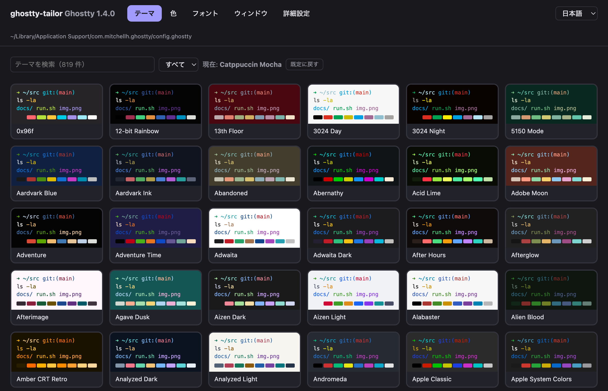
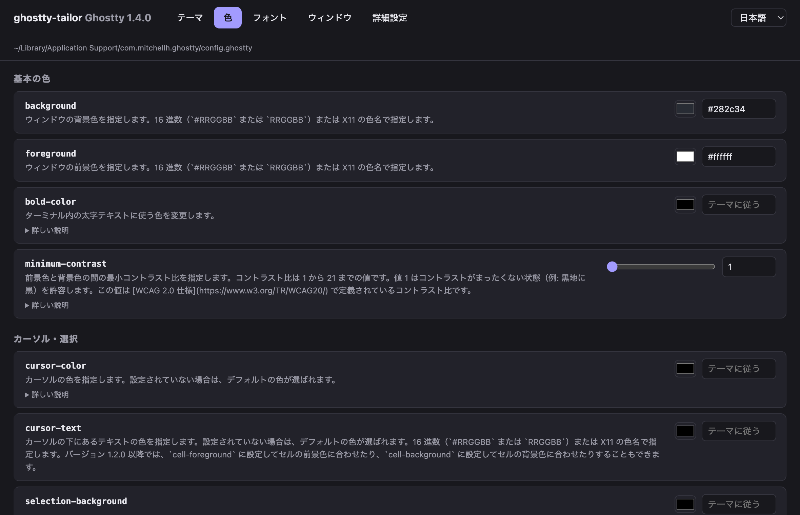
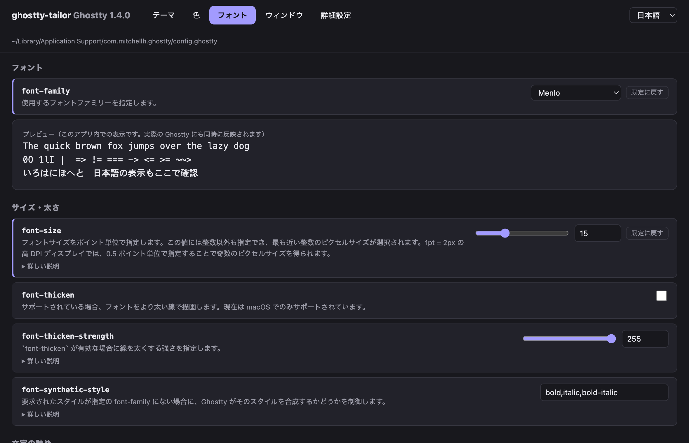
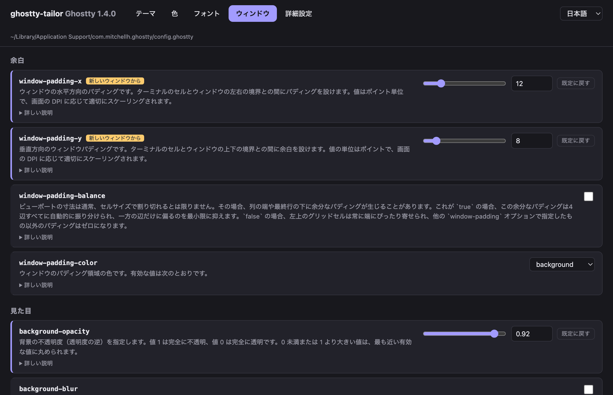
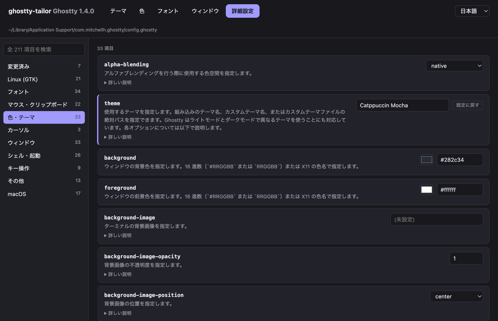

# ghostty-tailor

[English](README.md) | 日本語

[Ghostty](https://ghostty.org) の設定を GUI で仕立てるアプリです。すべての設定項目を一覧・変更でき、変更は起動中のターミナルにすぐ反映されます。

> **ステータス:** 試作段階です。macOS では Homebrew でインストールできます（[インストール](#インストール)を参照）。

> ghostty-tailor は有志による非公式プロジェクトであり、Ghostty プロジェクトとは関係ありません。

## なぜ作ったか

Ghostty の設定はテキストファイルで行います。柔軟な反面、どんな設定項目があり、それぞれ何をして、どんな値を受け付けるのかを把握しにくいのが難点です。ghostty-tailor はそれらを 1 つの画面にまとめます。

## スクリーンショット

| テーマ | 色 |
|---|---|
|  |  |

| フォント | ウィンドウ |
|---|---|
|  |  |

| 詳細設定 |
|---|
|  |

## 機能

- Ghostty に同梱の説明文付きで、すべての設定項目を一覧・検索できる
- テーマ・色・フォントを見た目で選べる
- 変更を起動中の Ghostty にすぐ反映する（macOS のみ）
- 英語と日本語の画面に対応。設定項目の説明文も日本語訳を同梱
- 既存の設定ファイルを読みやすいまま保つ。書き換えるのは変更した項目の行だけで、コメントなどはそのまま残る
- 変更のたびに `ghostty +validate-config` で検証し、不正な値なら自動で元に戻す

## インストール

### Homebrew（macOS）

```sh
brew install dandelion0216/tap/ghostty-tailor
```

インストール後は `ghostty-tailor` で起動できます。インストール時にお使いの Mac 上でソースからビルドするため（ビルドに使う Go は自動で入ります）、Apple の公証を受けていないアプリでも macOS に起動を止められません。Launchpad や Spotlight に表示したい場合は、次のコマンドを実行してください。

```sh
mkdir -p ~/Applications && ln -sf "$(brew --prefix)/opt/ghostty-tailor/ghostty-tailor.app" ~/Applications/
```

[Ghostty](https://ghostty.org) 1.x が必要です。

### ソースからビルド

必要なもの: [Go](https://go.dev)、[Wails v2 CLI](https://wails.io)。Node.js は不要です。

```sh
go install github.com/wailsapp/wails/v2/cmd/wails@latest
git clone https://github.com/dandelion0216/ghostty-tailor.git
cd ghostty-tailor
wails build -clean
```

macOS では `build/bin/ghostty-tailor.app` が作られます。Linux では `build/bin/ghostty-tailor` が作られます（GTK と WebKitGTK が必要です。[Wails のインストールガイド](https://wails.io/docs/gettingstarted/installation)を参照）。Linux でのビルドはまだ検証していません。

## 使い方

Ghostty がインストールされた環境で ghostty-tailor を起動します。設定ファイル（画面右上に表示）を読み込み、お使いの Ghostty のバージョンにある設定項目を一覧にします。

| タブ | できること |
|---|---|
| テーマ | 同梱テーマを検索し（ダーク / ライトで絞り込み可）、カードをクリックして適用する |
| 色 | 背景・文字・カーソル・選択範囲の色、不透明度、分割画面の色を設定する |
| フォント | `ghostty +list-fonts` の等幅フォントから選び、サイズや字間を設定してプレビューで確認する |
| ウィンドウ | 余白、不透明度、ぼかし、枠の装飾、カーソルの形、起動・終了時の動作を設定する |
| 詳細設定 | すべての設定項目を、左のカテゴリと検索欄から探して変更する |

- **言語:** 画面右上のメニューで English と日本語を切り替えられます。初回起動時は OS の言語設定に合わせ、選んだ言語は次回以降も使われます。同梱の訳より新しい Ghostty で説明文が変わった項目は、英語で表示されます。
- **既定に戻す:** 変更済みの項目には「既定に戻す」ボタンが出ます。押すと設定ファイルからその行を消し、Ghostty の既定値に戻ります。
- **反映タイミングの表示:** 新しいウィンドウから、または Ghostty の再起動後にしか効かない項目には、その旨のラベルが付きます。
- **自動バックアップ:** 初回起動時に、設定ファイルを同じ場所の `config.ghostty.bak-tailor` にコピーします。
- **即時反映（macOS）:** 変更のたびに AppleScript で Ghostty に設定の再読み込みを指示します。初回は「ghostty-tailor が Ghostty を制御しようとしています」という確認が macOS から出るので、許可してください。許可しなくても変更は保存され、次に Ghostty が設定を読み込んだときに反映されます。Linux では即時反映に未対応のため、Ghostty 側で手動で再読み込みしてください（既定のショートカット: `Ctrl+Shift+,`）。
- `keybind` や `palette` など複数行にわたる設定は、表示のみで編集はまだできません。

## 技術構成

- [Go](https://go.dev) + [Wails](https://wails.io)（画面は素の HTML / CSS / JS）
- macOS と Linux

## ライセンス

[MIT](LICENSE)
