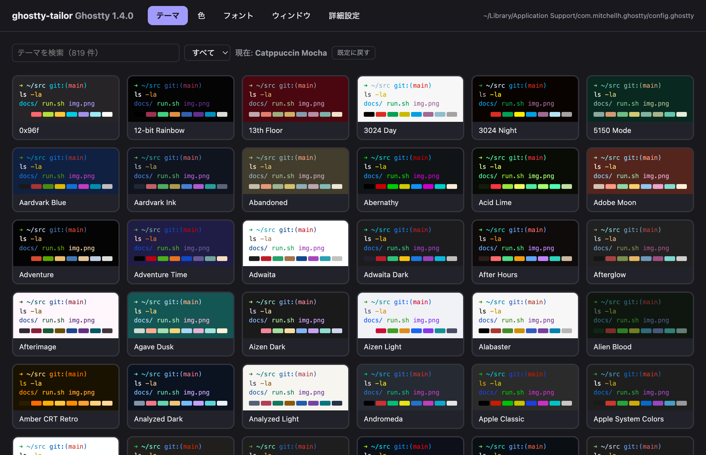
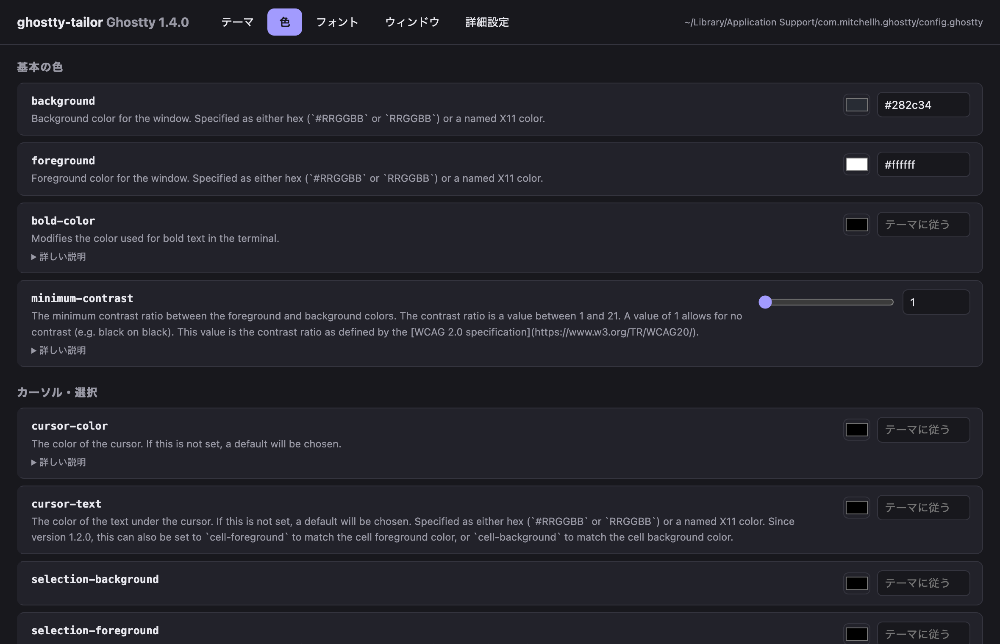
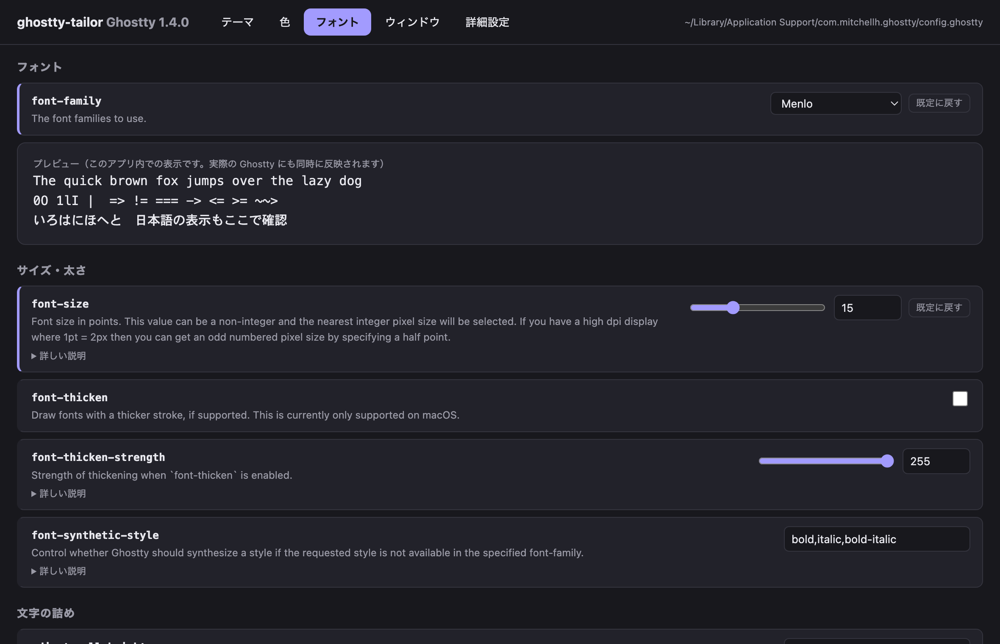
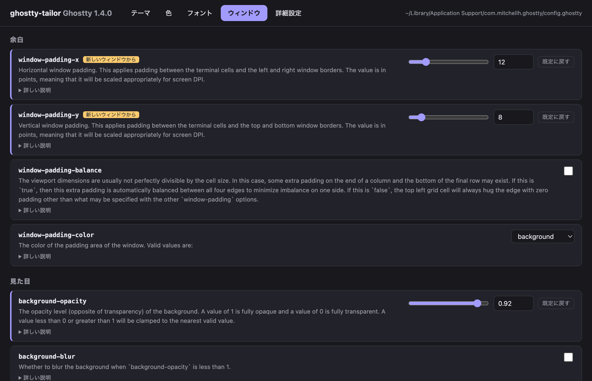
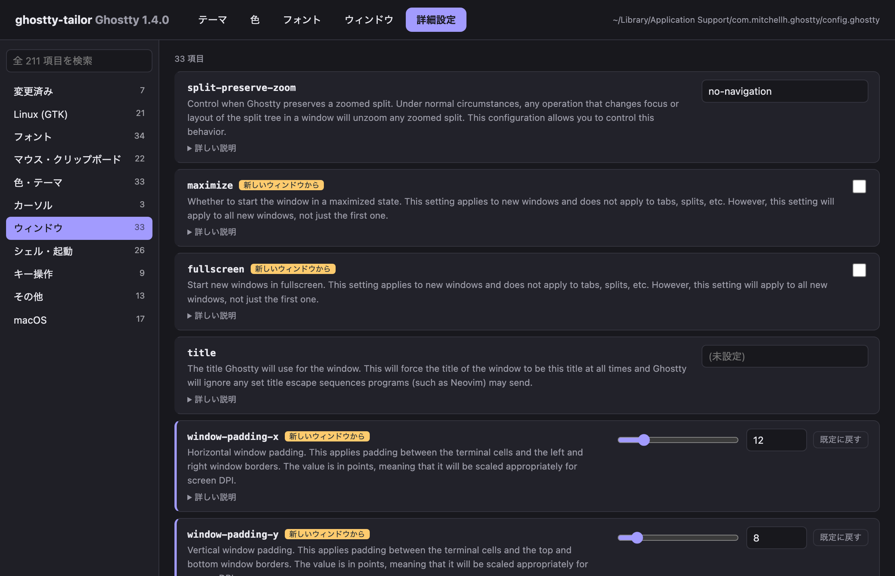

# ghostty-tailor

English | [日本語](README.ja.md)

A GUI for tailoring your [Ghostty](https://ghostty.org) configuration — browse every option, tweak it, and see the change in your running terminal right away.

> **Status:** early prototype. There is no packaged release yet; build it from source (see [Install](#install)). The UI is currently in Japanese.

> ghostty-tailor is an unofficial community project and is not affiliated with the Ghostty project.

## Why

Ghostty is configured with a plain text file. It is powerful, but it is hard to know which options exist, what they do, and what values they accept. ghostty-tailor puts all of that on one screen.

## Screenshots

| Theme | Colors |
|---|---|
|  |  |

| Font | Window |
|---|---|
|  |  |

| Advanced |
|---|
|  |

## Features

- Browse and search every config option, with the documentation Ghostty ships with
- Pick themes, colors and fonts visually
- Apply changes to the running Ghostty instantly (live reload, macOS)
- Keep your existing config file readable — only the lines for the options you change are rewritten; comments and everything else stay as they are
- Every change is checked with `ghostty +validate-config`; an invalid change is rolled back automatically

## Install

Requirements: [Ghostty](https://ghostty.org) (1.x), [Go](https://go.dev) and the [Wails v2 CLI](https://wails.io). Node.js is not needed.

```sh
go install github.com/wailsapp/wails/v2/cmd/wails@latest
git clone https://github.com/dandelion0216/ghostty-tailor.git
cd ghostty-tailor
wails build -clean
```

On macOS the app is created at `build/bin/ghostty-tailor.app`. On Linux the binary is `build/bin/ghostty-tailor` (Wails needs GTK and WebKitGTK; see the [Wails installation guide](https://wails.io/docs/gettingstarted/installation)). Linux builds have not been tested yet.

Homebrew distribution is planned.

## Usage

Launch ghostty-tailor while Ghostty is installed. It reads your config file (shown at the top right) and lists the options from your Ghostty version.

| Tab | What you can do |
|---|---|
| Theme | Search the bundled themes (filter by dark / light) and click a card to apply it |
| Colors | Set background, foreground, cursor and selection colors, opacity and split colors |
| Font | Choose a monospace font from `ghostty +list-fonts`, set its size and spacing, and check the preview |
| Window | Padding, opacity, blur, decorations, cursor style and startup / close behavior |
| Advanced | Every option, grouped by category on the left, with a search box |

- **Reset:** an option you have changed shows a reset button that removes its line from the config file, so Ghostty falls back to the default.
- **Reload badges:** some options only take effect in new windows or after restarting Ghostty; they are labeled as such.
- **Automatic backup:** on first launch your config file is copied to `config.ghostty.bak-tailor` next to it.
- **Live reload (macOS):** after each change ghostty-tailor asks Ghostty to reload its config via AppleScript. The first time, macOS asks whether ghostty-tailor may control Ghostty — allow it to get live reload. If you deny it, changes are still saved and take effect the next time Ghostty reloads its config. Live reload on Linux is not supported yet; reload manually in Ghostty (default: `Ctrl+Shift+,`).
- Multi-line options such as `keybind` and `palette` are shown but cannot be edited yet.

## Stack

- [Go](https://go.dev) + [Wails](https://wails.io) (plain HTML / CSS / JS frontend)
- macOS and Linux

## License

[MIT](LICENSE)
