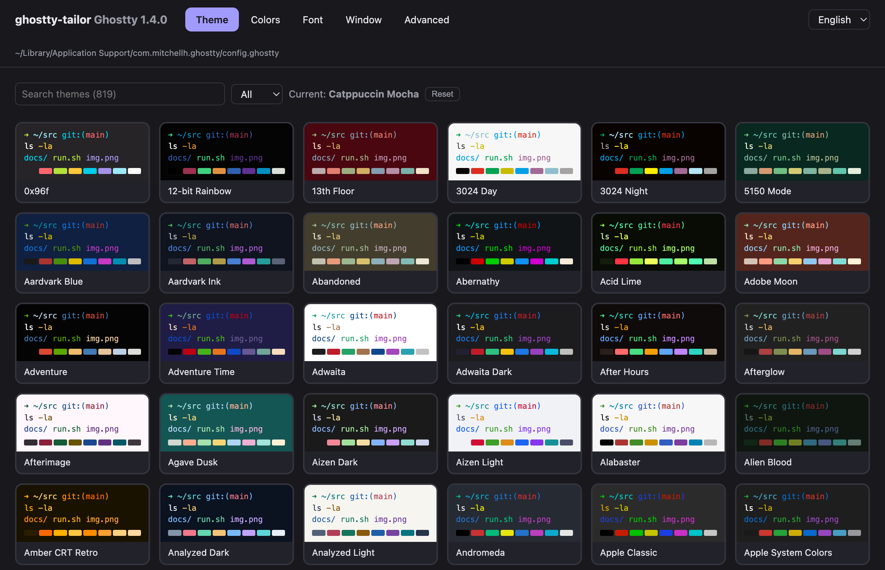
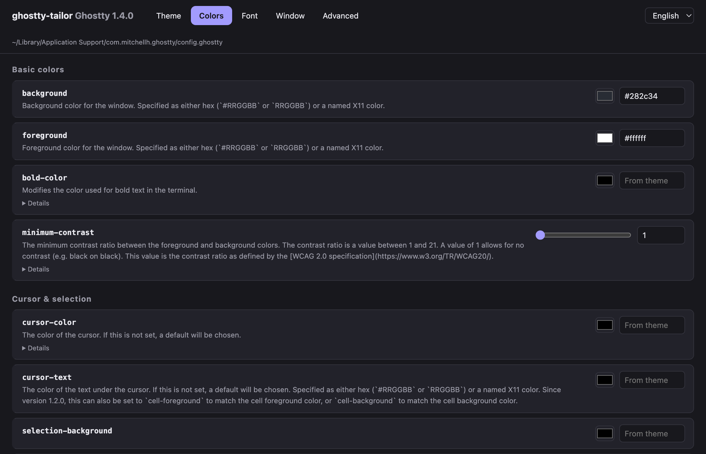
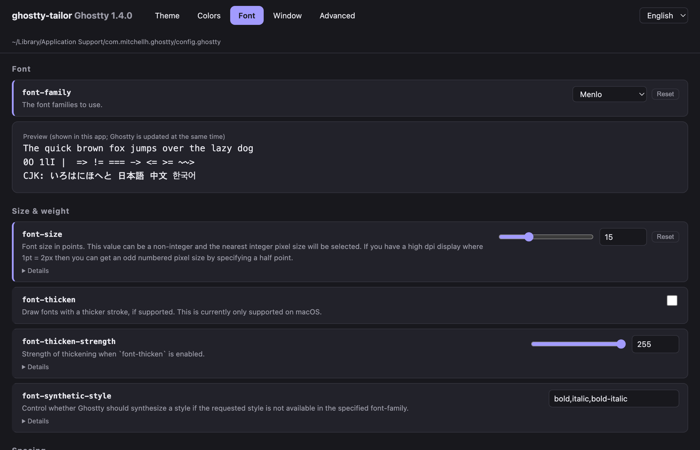
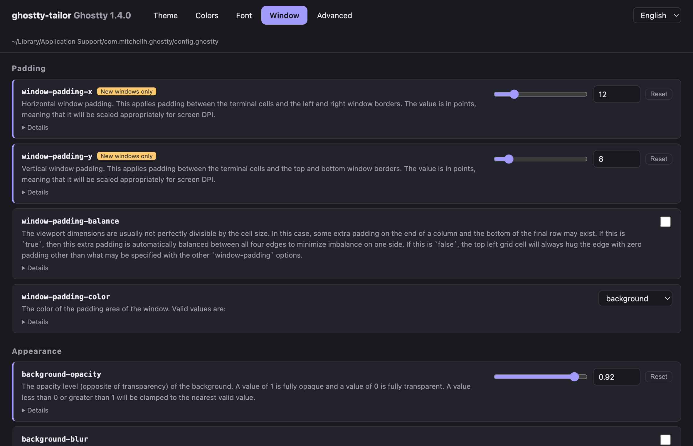
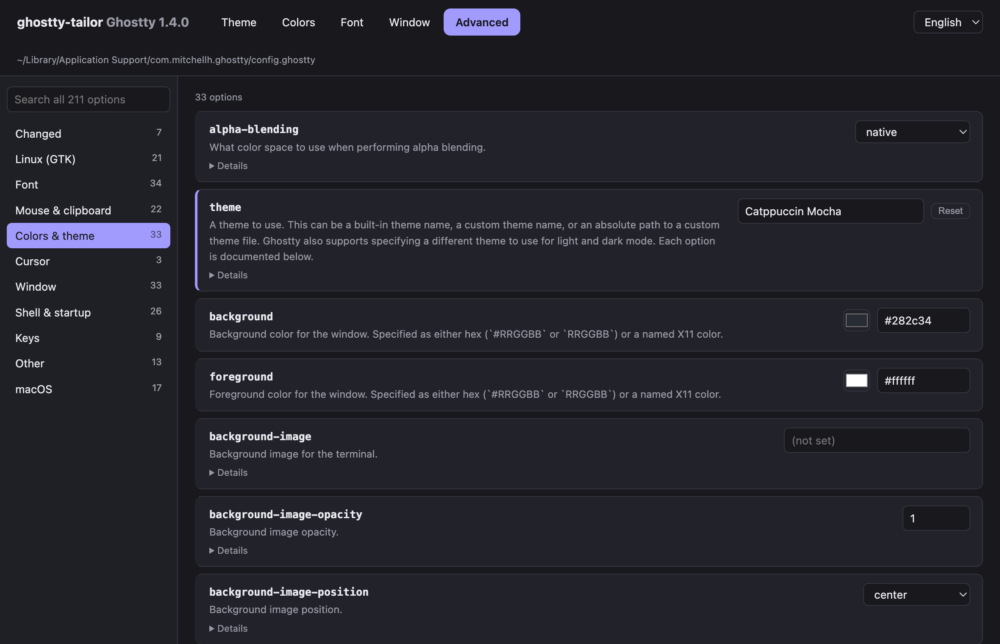

# ghostty-tailor

English | [日本語](README.ja.md)

> [!IMPORTANT]
> **ghostty-tailor is an unofficial, independent project. It is not affiliated with, endorsed by, or maintained by the Ghostty project or its developers.**
> Please report problems with ghostty-tailor to [this repository's issues](https://github.com/dandelion0216/ghostty-tailor/issues), not to Ghostty.

A GUI for tailoring your [Ghostty](https://ghostty.org) configuration — browse every option, tweak it, and see the change in your running terminal right away.

> **Status:** early prototype. Install it with Homebrew on macOS (see [Install](#install)).

## Why

Ghostty is configured with a plain text file. It is powerful, but it is hard to know which options exist, what they do, and what values they accept. ghostty-tailor puts all of that on one screen.

## Screenshots

| Theme | Colors |
|---|---|
|  |  |

| Font | Window |
|---|---|
|  |  |

| Advanced |
|---|
|  |

## Features

- Browse and search every config option, with the documentation Ghostty ships with
- Pick themes, colors and fonts visually, and edit the 16-color palette
- Change keyboard shortcuts like in macOS System Settings: click a shortcut and press the new keys
- Apply changes to the running Ghostty instantly (live reload, macOS)
- English and Japanese UI, including Japanese translations of the option documentation
- Keep your existing config file readable — only the lines for the options you change are rewritten; comments and everything else stay as they are
- Every change is checked with `ghostty +validate-config`; an invalid change is rolled back automatically

## Install

### Supported Ghostty versions

Ghostty 1.2 or later on Linux and 1.3 or later on macOS. Tested with Ghostty 1.4.0 on macOS and 1.3.0 on Ubuntu 26.04.

Live reload is what needs these versions: on macOS it uses AppleScript (added in Ghostty 1.3), on Linux `SIGUSR2` (1.2). With an older Ghostty, changes are still saved and take effect the next time Ghostty reloads its config. On macOS live reload is also off if `macos-applescript = false` is set.

### Homebrew (macOS)

```sh
brew install dandelion0216/tap/ghostty-tailor
```

Then start it with `ghostty-tailor`. The app is built from source on your Mac during installation (Go is installed automatically as a build dependency), so macOS does not block it even though it is not notarized. To show it in Launchpad and Spotlight:

```sh
mkdir -p ~/Applications && ln -sf "$(brew --prefix)/opt/ghostty-tailor/ghostty-tailor.app" ~/Applications/
```

Requires [Ghostty](https://ghostty.org) 1.x.

### Homebrew (Linux)

The same command works with [Homebrew on Linux](https://docs.brew.sh/Homebrew-on-Linux). GTK 3 and WebKitGTK are installed as dependencies, and `ghostty-tailor` is installed as a command. Live reload needs Ghostty 1.2 or later.

### From source

Requirements: [Go](https://go.dev) and the [Wails v2 CLI](https://wails.io). Node.js is not needed.

```sh
go install github.com/wailsapp/wails/v2/cmd/wails@latest
git clone https://github.com/dandelion0216/ghostty-tailor.git
cd ghostty-tailor
wails build -clean
```

On macOS the app is created at `build/bin/ghostty-tailor.app`. On Linux the binary is `build/bin/ghostty-tailor` (Wails needs GTK 3 and WebKitGTK 4.1; build with `wails build -tags webkit2_41`, and see the [Wails installation guide](https://wails.io/docs/gettingstarted/installation)). Linux builds are tested on Ubuntu in CI.

## Usage

Launch ghostty-tailor while Ghostty is installed. It reads your config file (shown at the top right) and lists the options from your Ghostty version.

| Tab | What you can do |
|---|---|
| Theme | Search the bundled themes (filter by dark / light) and click a card to apply it |
| Colors | Edit the 16-color palette, and set background, foreground, cursor and selection colors, opacity and split colors |
| Font | Choose a monospace font from `ghostty +list-fonts`, set its size and spacing, and check the preview |
| Window | Padding, opacity, blur, decorations, cursor style and startup / close behavior |
| Keys | Every shortcut, grouped like macOS keyboard settings. Click a shortcut and press new keys to change it, untick it to disable a default, or add a new one. Conflicts are replaced and reported |
| Advanced | Every option, grouped by category on the left, with a search box |
| History | Export your config to a file or import one (with a list of what will change), and restore any of the last 50 states saved before each change |

- **Included files:** options also set in a file loaded with `config-file` are marked, with the value that file sets. Those files are loaded after the main one, so their value wins. ghostty-tailor only edits the main file.
- **Light / dark:** follows your system appearance. On Linux the desktop's dark style is read when ghostty-tailor starts.
- **Language:** switch between English and 日本語 with the menu at the top right. The first launch follows your OS language, and your choice is remembered. Option docs that changed in a newer Ghostty than the bundled translations are shown in English.
- **Reset:** an option you have changed shows a reset button that removes its line from the config file, so Ghostty falls back to the default.
- **Reload badges:** some options only take effect in new windows or after restarting Ghostty; they are labeled as such.
- **Automatic backup:** on first launch your config file is copied to `config.ghostty.bak-tailor` next to it. After that, the state before each change is kept in the History tab (stored in `~/Library/Application Support/ghostty-tailor/history/` on macOS, `~/.config/ghostty-tailor/history/` on Linux).
- **Live reload:** after each change ghostty-tailor asks the running Ghostty to reload its config.
  - macOS: via AppleScript (Ghostty 1.3 and later). The first time, macOS asks whether ghostty-tailor may control Ghostty — allow it to get live reload. If you deny it, changes are still saved and take effect the next time Ghostty reloads its config.
  - Linux: by sending `SIGUSR2` to your own Ghostty processes, which Ghostty 1.2 and later treat as "reload config". With older Ghostty, reload manually (default: `Ctrl+Shift+,`).
- **Options that can be repeated** (`font-family`, `font-feature`, `config-file`, `env`, ...) are edited as a list in the Advanced tab: add, remove and reorder values. Picking a font in the Font tab only changes the first `font-family`, so fallback fonts are kept.

## Stack

- [Go](https://go.dev) + [Wails](https://wails.io) (plain HTML / CSS / JS frontend)
- macOS and Linux

## Acknowledgements

Thank you to [Mitchell Hashimoto](https://github.com/mitchellh) and all [Ghostty contributors](https://github.com/ghostty-org/ghostty/graphs/contributors) for building such a fast, thoughtful terminal — and for documenting every config option so thoroughly. ghostty-tailor would not exist without that work: the option list and documentation it shows come straight from Ghostty, and the themes it previews are the ones Ghostty ships with.

## Contributing

Bug reports, ideas and pull requests are welcome — see [CONTRIBUTING.md](CONTRIBUTING.md). English or Japanese is fine.

## License

[MIT](LICENSE)

The bundled Japanese translations of Ghostty's option documentation are derived from Ghostty (MIT License). The app also includes [Wails](https://wails.io) and other Go modules. See [THIRD_PARTY_NOTICES.md](THIRD_PARTY_NOTICES.md) for their licenses.
